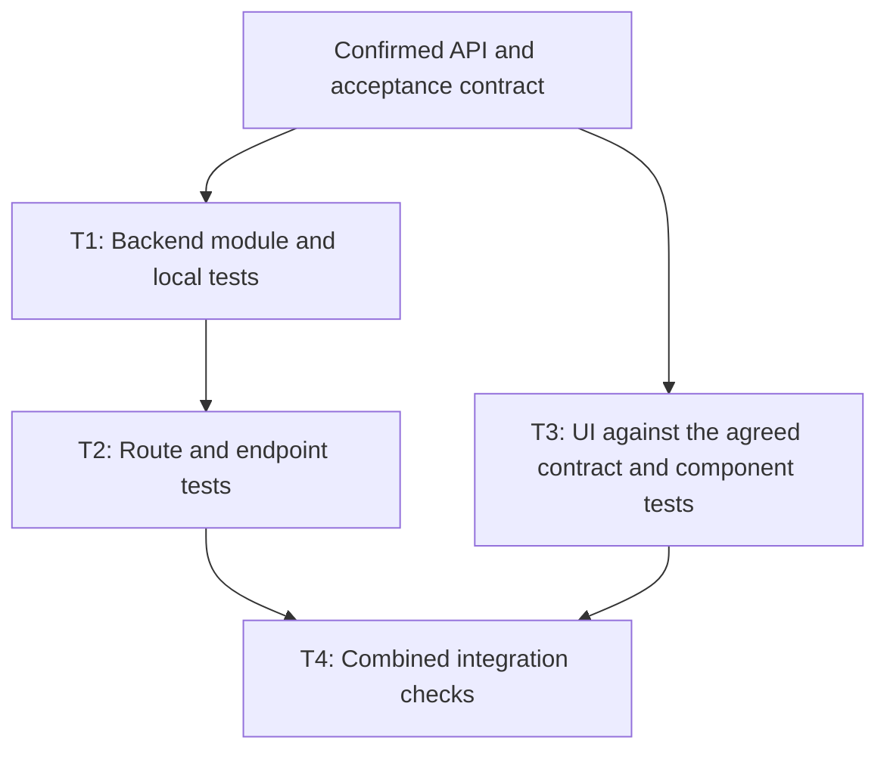

# One-shot tasks composed into features

Status: revised strategy, 2026-11-07; task composition is not implemented. This replaces the preceding Quick/Feature/Mix proposal in this document. It is the current next-stage handoff after [IMPLEMENTATION_RESULTS.md](IMPLEMENTATION_RESULTS.md); the independent evaluation, scope and correctness requirements in [NEXT_PLAN.md](NEXT_PLAN.md) remain applicable.

Use one reusable **Devstill Task**: a compact objective, focused local retrieval, bounded execution and a clear validation result. A small request produces one task. A larger request produces several tasks with explicit dependencies and shared contracts. Optimize each task for first-attempt success and validate the combined feature.

The important new question is how many coherent tasks the request needs, not which execution mode to select. Decomposition adds a bounded planning step and deterministic scheduling; it must not become recursive agent planning or an unlimited repair loop. Current results support testing this direction, not claiming it already works.

## What the latest review establishes

The review recomputed role coverage from saved outputs against `werkzeug.changes.v2_1.json`, checking the pinned clean corpus and evidence hashes. It made no new embedding or Qwen calls. The machine-readable audit, including source hashes, is `.devstill/retrieval-strategy-v4/role-audit.json`.

| Development workload | Required evidence in current candidate pool | Required evidence in selected context | Complete selected contexts |
| --- | --- | --- | --- |
| Five small edits | 90% | 90% | 4/5 |
| Five features | 70% | 65% | 0/5 |
| Same five features, earlier Qwen-facet prototype | 93.3% | 61.7% | 1/5 |

These percentages are means of per-task evidence-group coverage, not file-hit rates. All cases are exposed development probes with same-author labels. The facet prototype used larger pools and a larger chunk cap; its comparison is diagnostic, not a controlled improvement claim. Four facet pools contained every labeled group, versus one current pool. Pool completeness is an upper bound without a token constraint, not proof all evidence fits a valid prompt.

| Feature | Missing from current pool | Additional loss during current selection | First useful experiment |
| --- | --- | --- | --- |
| Upload limits | Request entry point and parser implementation | None | Retrieve the request-to-parser connection, alongside the already found tests/docs. |
| Cookie priority | Tests | None | Resolve source-to-test references while retaining the serializer and entry point. |
| Directory downloads | Nothing | Implementation | Retain traversal enforcement alongside entry point and both test roles. |
| Numeric route converter | Integration | None | Retrieve converter registration/use, preserving the numeric implementation. |
| Strict value conversion | Tests | None | Retrieve conversion regression tests without drifting to duplicate-key rejection. |

Four of five current feature pools lack required groups. A perfect selector restricted to those pools could make at most **one of five** complete. Selection remains important: earlier facets often recovered the missing groups but then dropped them. The next work therefore needs both candidate discovery and context selection, measured separately.

There are also two planning-contract problems:

- `src/devstill/deep_planning.py::run_deep_plan` generates an initial full plan, searches from its reasons, then generates a final full plan. Its merge retains initial chunks even when better evidence arrives. That spends a second planning call and can preserve weak context.
- `src/devstill/planning.py::_SYSTEM_PROMPT` asks for a file-impact classification with one short reason per file. Every retrieved path must receive a label. This helps organize edits, but it does not require acceptance criteria, behavioral constraints, connected change steps or a validation plan; irrelevant retrieved files can become forced Read rows. Valid JSON does not establish a sufficient feature plan.

The existing Qwen planning run already demonstrates a useful speed baseline: all twelve plans used one successful HTTP generation request with `reasoning_mode=off`, with no compatibility fallback or schema repair. Selection, tokenizer calls and planning together took a median 3.64 seconds, ranging from 2.26 to 6.67 seconds. These are single samples per request, exclude retrieval, and do not establish p95 latency or semantic plan quality. Sources are `.devstill/retrieval-implementation-v3/qwen-plans/{plans,agent}.jsonl`; the checked summary is `.devstill/retrieval-strategy-v4/planning-audit.json`.

The larger test repository is **Cargo**, an established Rust project pinned to commit `8f40fc59fb0c8df91c97405785197f3c630304ea`: 2,440 tracked text files and 15,384 indexed search units. Werkzeug is the smaller Python corpus, with 302 tracked files. Cargo's final pilot achieved 11/12 file hits but only 7/12 evidence hits and complete contexts. Its twelve questions are development lookups across three families, not a feature-building acceptance set. Both repos remain available under `/tmp/devstill-retrieval-bench/repos/`.

## One task type; a plan supplies the dependencies

Use **Devstill Task** in the product. A **Task Plan** describes one or more tasks and their dependencies; a **Run** executes one confirmed version of that plan. “Task graph” is the technical name for the dependency structure, and “node” can remain an internal implementation term. “Unit” is reasonable internally, but “task” makes outcomes and progress easier to describe: “three tasks, two ready, one waiting.” No separate Quick, Feature or Mix execution modes are required.

A task is **one coherent, verifiable outcome that can be completed from a compact evidence bundle**. It can touch several files. It is not defined by a file count, a time estimate, or a single edit operation. Prefer the fewest tasks that can each succeed on their first attempt. A feature that fits one task stays one task; larger work becomes a small dependency graph.

```text
request
  -> bounded local discovery
  -> one compact Task Plan, containing one or several tasks
  -> one confirmation of outcomes, scope and contracts
  -> ready tasks retrieve focused context, execute once, and validate
  -> verify the combined outcome
```

For a one-task request, reuse the initial evidence bundle when it is still current. For a multi-task request, initial discovery finds the architecture and integration contracts; each ready task retrieves its own focused implementation evidence. Local retrieval after a predecessor changes the repository is the successor's initial retrieval, not a failed retry. Count both request-level discovery and task retrieval in total cost.

The existing Quick method becomes the execution primitive. A task card from the confirmed plan supplies its objective and constraints, so there is no mandatory second planning conversation for every child. The scheduler decides readiness from explicit dependencies and validation results; it does not ask Qwen what to do next after each action.

Python's standard-library [TopologicalSorter](https://docs.python.org/3/library/graphlib.html) illustrates the needed readiness and cycle-detection mechanics. It does not provide source isolation, semantic dependency detection or validation. A new orchestration framework is not a prerequisite for the experiment.

## Task boundaries and shared contracts

Every task card needs these fields before coding:

| Field | Purpose |
| --- | --- |
| Outcome and acceptance conditions | State the observable result and its check; connect it to the original request. |
| Dependencies and required inputs | Name predecessor tasks and the exact accepted artifacts/contracts needed from them. |
| Source anchors and evidence references | Locate current implementation, integration points and relevant test patterns; distinguish verified existing symbols from proposed new ones. |
| Read scope and write ownership | Describe permitted edits and important shared dependencies; include generated outputs and shared configuration. |
| Interface commitments | Declare APIs, shapes, defaults, errors and compatibility constraints that other tasks rely on. |
| Validation | Define local checks and any cross-task checks that must wait for successors. |
| Budget and evidence status | Bound retrieval, context and execution; disclose partial/unresolved evidence before acting. |
| Deliverable | Identify the patch/artifact, revision/content hashes, changed symbols/contracts, checks and remaining gaps. |

Use a small shared request brief containing acceptance conditions, agreed interfaces and constraints. Pass each task the relevant portion plus its own evidence. Do not copy every sibling's snippets or conversation into every prompt. Handoffs contain verified artifact references and test results; downstream tasks read the actual changed code. An upstream model's prose summary is not evidence that its implementation exists or works.

The request-level planner needs enough repository context to choose valid boundaries. Decomposition cannot recover an integration point it never discovered. Keep the earlier work on scoped exact anchors, bounded relationships, test references and complementary evidence selection. Local embeddings help locate candidate code; relationships and contracts connect it into a usable task. No gold benchmark roles or paths may enter runtime planning or retrieval.

Split when outputs have a clear interface, separate acceptance conditions and meaningfully smaller evidence requirements. Keep tightly coupled edits together when they depend on the same invariant, require synchronized changes, or would mostly duplicate context across tasks. A backend module and its route can be one task if both fit; splitting them is not automatically better. Avoid chains of trivial one-line tasks merely to make task-level success look high.

New capabilities need existing extension points and repository conventions. A request with unresolved product behavior or incompatible interfaces may need clarification at the normal plan confirmation. A graph cannot make that ambiguity disappear.

## Ordered and independent work

For an endpoint and UI, the confirmed plan could look like this. The shared API contract is an agreed input; if a generated schema or common type file must be created first, add an explicit prerequisite task for that artifact.



T1 and T3 are eligible to run independently if they consume the frozen contract and their source/resources do not conflict. T2 waits for T1's validated module. T4 waits for both branches. UI work against a contract/mock does not establish that the real backend integration works; T4 closes that gap. Each implementation task still owns its relevant local tests. A final test task is for cross-task acceptance, not a reason to postpone every regression check.

“Backend” and “frontend” labels alone do not establish independence. Check shared schemas/types, build files, lockfiles, generated clients, database state, test ports and read/write conflicts. Changes to a source file another task assumes stable may require ordering even when write sets do not overlap. A shared contract has one owner; changes invalidate affected downstream tasks rather than silently changing their input.

Start by executing the graph serially. Add parallel scheduling only after sequential composition works and isolated execution passes. Parallel tasks need separate working copies or an equivalent proven isolation mechanism, stable base revisions and a controlled integration step. Validate accepted patches in the combined tree. A clean textual merge is not a semantic integration check. Default to ordering or combining tasks when ownership or dependency information is uncertain.

Parallel-ready does not mean parallel execution is faster on one local Qwen server. Measure throughput, memory contention and end-to-end critical-path time before increasing concurrency. This proposal does not start additional agents or certify the current multi-session runtime.

## Preserve the compact, mostly one-shot execution contract

These are proposed experiment limits to freeze before evaluation, not measured winners:

- One request-level planning generation, with thinking disabled, emits the shared brief and task cards together. Start with a maximum of six tasks including integration work; if the request cannot fit coherently, return a narrower proposed scope instead of recursively creating more tasks. Use the same Task Plan schema for a single task.
- One ordinary retrieval wave per task. A wave consists of one task query plus bounded exact-reference lookups and, where relevant, one-hop relationships. Start from the current 12-result pool; test up to 12 additional relationship candidates separately under matched budgets. No recursive graph traversal or compulsory model query rewrite.
- Start with the current five-chunk context ceiling and 8,192-token full input ceiling. Include the task card, shared contract, handoff records, source, chat framing and instructions; reserve output separately. Pack task-specific evidence and backfill after overlap/size rejection. Missing essentials make a task partial, not “ready” simply because five chunks were found. Any larger context setting is a separate measured operating point.
- Allow one targeted retrieval retry for a concrete gap. A second is available only under an explicit higher-budget setting. Keep the hard per-task ceiling at three waves, and an additional **run-wide allowance of two extra retrieval waves total**, including retries during initial discovery. The smaller remaining allowance wins. This prevents six tasks each silently spending a fresh two-retry budget.
- Normal coding uses one attempt from the task card and retrieved evidence, followed by deterministic application/checks. The first prototype should measure a single patch-producing generation per code task; a task with an already specified check may need no model generation. Do not automatically run a new plan/code cycle after a failed check.
- One structured-format repair may be allowed across the entire run and must count in actual requests and tokens. A coding-format repair loses strict first-attempt status for that task. Behavior-changing repair after test feedback is a separate recovery attempt, disabled by default in the first-pass benchmark. Tasks cannot create children or relabel repairs as new planned tasks.

Normal model cost for a composed request is approximately **one plan generation plus one coding generation per code-producing task**, with zero extra planning generations required per child. The coding adapter must actually enforce or measure this: one logical “task” or one `chat` invocation is not proof of one HTTP generation. Current `AgentClient.chat` can negotiate compatibility with up to three HTTP attempts and can remove the reasoning-off setting. Freeze supported capabilities before timing, log all actual attempts, and stop on a mismatch rather than silently call an `auto` run non-thinking. If an existing coding adapter uses model/tool rounds, report those rounds separately and do not call that result a single-generation execution.

Confirm the Task Plan once, then run tasks inside its scope. Routine reads needed to edit files and declared validation commands are execution work; count them without treating them as new semantic-search waves. A blocking missing contract, changed interface or out-of-scope edit pauses the affected work for a plan amendment. Routine successful tasks need no additional confirmation.

Keep the accepted plan version immutable during a run. A blocked task does not unblock its successors. Independent tasks may finish, but the feature is incomplete until all required outcomes and combined checks pass. Use explicit states such as waiting, ready, running, validated, blocked and failed. Mark completion only after checks and patch integration succeed; a model's “done” message is insufficient.

## Evidence freshness between tasks

At task start, build context against its execution snapshot, including accepted predecessor changes. Incrementally update the index or use a clearly identified local delta overlay for changed/new/deleted files; stale base hits must be removed or refreshed. Proposed symbols become existing evidence only after their artifacts exist. A run cannot require every task to use the original repository snapshot after predecessors have changed it.

Keep source hashes and a revision identity on each evidence bundle and handoff. Before applying a task's patch, check relevant source preconditions. If a sibling changed the task's assumptions, invalidate its pending execution and account for any refreshed retrieval/re-execution. Avoid silently replaying stale patches. Shared immutable index data can be reused, but branch-specific overlays and planner artifacts must be isolated.

This is a material prerequisite: existing index invalidation, multi-process mutation, per-session artifacts and recovery issues remain open. First test freshness serially; parallel execution must not arrive ahead of those checks.

## Benchmark task composition, not just task retrieval

The earlier results justify improving discovery and selection. They do **not** establish that splitting features will solve the failures. Fewer tokens per task can help, while extra calls, duplicated context and interface errors can consume the gain. Measure the original feature outcome as well as each task.

| Experiment | What stays controlled | What it answers |
| --- | --- | --- |
| One-task regression | Existing small-edit requests, index, full-input limits and model settings | Does the new task wrapper preserve compact retrieval and first-pass behavior without adding a mandatory decomposition call? |
| Human-reviewed fixed task plans | Same feature, source revision, interface brief and acceptance conditions; serial execution | Can compact tasks compose successfully when decomposition is supplied? This is an oracle-plan diagnostic, not deployable end-to-end performance. |
| Generated plans | Same requests and task executor; no gold task boundaries/roles in planner input | Can one planning generation discover sufficient tasks, correct dependencies and shared contracts? |
| Whole-feature vs task plan | Same features, independent acceptance checks, comparable aggregate token/call budgets | Does decomposition improve complete outcomes or merely spend more compute? Also report each policy's normal-budget operating point. |
| Task granularity | One cohesive task vs a small split vs deliberate over-splitting | Where does reduced context stop paying for extra calls and handoffs? |
| Sequential vs parallel schedule | Same frozen graph and task inputs/settings, with isolated workspaces and integration checks | Does concurrency reduce wall time without contract, freshness or merge regressions? |
| Bounded recovery | First-pass baseline vs explicit retrieval/recovery allowances | How much improvement comes from retries, and are both task and run caps enforced? |

Run retrieval and plan-quality replay first, then an isolated coding track on explicitly prepared, disposable checkouts with recorded validation commands. This strategy update does not itself execute patches or another project's tests. Start serially with a few complete features; commission the fresh independent acceptance families from NEXT_PLAN before promoting a policy. Keep related subsystems and paraphrases in the same split. Cargo is useful for scale and Rust parsing, but its existing lookup pilot is not evidence for multi-task feature implementation or frontend/backend integration. Add cases with real contracts, dependent edits and parallel branches rather than rename lookup questions.

Required reports:

- Per-task anchor/evidence completeness, useful token share, first-attempt patch/check success, missing-contract rate and task retries.
- Per-feature acceptance coverage and **complete end-to-end success**. All tasks passing local tests is insufficient if the requested behavior or integration fails. Attribute omissions to decomposition, retrieval, planning, coding, handoff or integration.
- Total planning/coding/repair HTTP requests, input/output tokens, repeated evidence, index/delta update cost and validation cost. Show per-task latency, total compute and wall-clock critical path; repeated latency samples are not additional independent feature cases.
- Graph validity (cycles, unknown dependency IDs, conflicts), missing acceptance ownership, incorrect parallelism and stale successor context. Structural checks cannot prove semantic decomposition quality; use independent source/plan review.
- Small-edit regressions and whole-feature outcomes at matched aggregate budgets. An 8,192-token ceiling for every task is **not** an equal-total-budget comparison with one 8,192-token feature prompt. Report measured actual usage and the performance/cost tradeoff.

Retain the earlier proposed small-edit anchor/evidence gates and negative/scope/freshness checks. For feature retrieval, report both each task's evidence and coverage of the original feature's requirements across task boundaries; do not turn a low feature score into many easy task successes. No code-success threshold is justified by the existing retrieval-only scores. Establish a first coding baseline, freeze acceptance and latency thresholds, then use fresh acceptance cases. The earlier 90% evidence coverage/80% complete-context targets concern retrieval, not successful feature implementation.

Keep the independent index-quality work: Cargo demonstrated an approximate-search miss at exact cosine rank 33 across rebuilds. Test ANN search depth against stored-vector exhaustive results, audit truncated inputs and real-source parse failures, and keep models/indexes warm for latency measurements. Task decomposition does not fix these shared retrieval errors. [Chroma's configuration documentation](https://docs.trychroma.com/docs/collections/configure) explains the search-depth recall/latency tradeoff; verify the installed version before experimenting on a separate index.

## Immediate next handoff

Build a benchmark-only Task Plan representation, structural validator and **serial** executor/replay adapter. Reuse the existing Quick retrieval/context primitives. Supply two or three independently reviewed task plans for the known feature gaps, with a single-task control and an explicit shared contract. Measure retrieval/plan sufficiency before coding. Then compare generated plans to those supplied plans; add concurrency only after composition, freshness and integration pass.

Keep source-linked discovery and context-selection experiments from the previous strategy as supporting work. Automatic Quick/Feature/Mix routing is removed from the roadmap: one request produces one Task Plan, and its tasks all use the same compact execution contract. This document is a design and benchmark handoff; no production task scheduler or feature implementation was installed.
